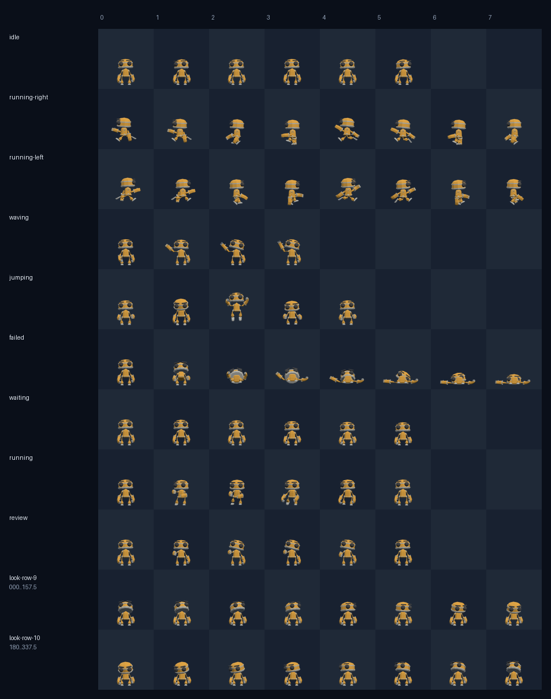

# RobotExpressive Codex Pet

[](https://github.com/KanadeK/robot-expressive-codex-pet/actions/workflows/ci.yml)
[](https://kanadek.github.io/robot-expressive-codex-pet/)
[](https://github.com/KanadeK/robot-expressive-codex-pet/releases/latest)
[](ASSET_LICENSE.md)
[](LICENSE)

**A complete Codex v2 desktop pet built from the real, CC0-licensed
[RobotExpressive][model-source] character in the official three.js repository.**
It ships a reproducible offline WebGL renderer, strict atlas validator,
deterministic packager, animated previewer, transactional installer, backup,
recovery, and diagnostic CLI.

[中文说明](README.zh-CN.md) ·
[Live animation lab](https://kanadek.github.io/robot-expressive-codex-pet/) ·
[Download the latest release](https://github.com/KanadeK/robot-expressive-codex-pet/releases/latest)



## It is a working tool, not a sprite-only repository

- A real `1536x2288` RGBA/WebP Codex v2 atlas: 9 semantic animation rows and
  16 clockwise look directions.
- 73 poses rendered from the model's original skeletal clips, including
  `Idle`, `Running`, `Wave`, `Jump`, `Death`, `Sitting`, `Punch`, and
  `ThumbsUp`.
- An offline Three.js + Playwright renderer that consumes the pinned GLB—no API
  key, cloud image generator, or manual frame painting required.
- Cell-level validation for dimensions, transparency, required/unused cells,
  clipping risk, hidden RGB, manifest safety, and SHA-256 integrity.
- Byte-for-byte deterministic `.codex-pet.zip` builds with fixed ZIP metadata.
- Animated GIFs, a contact sheet, and a browser lab that reads the shipped
  atlas rather than mock assets.
- Safe ZIP extraction, transactional replacement, automatic backup,
  recoverable uninstall, installed-pet doctor, JSON output, tests, CI, Pages,
  release automation, provenance, and a repair playbook.

RobotExpressive is an existing character, not an invented imitation. The model
README credits Tomás Laulhé for the model and Don McCurdy for modifications,
and releases it under CC0 1.0. This repository pins the exact upstream commit
and source-file SHA-256.

## Install

The ready-made release needs Python 3.11 or newer:

```bash
python -m pip install .
robot-pet validate pet
robot-pet install pet
robot-pet doctor
```

The installer targets
`${CODEX_HOME:-$HOME/.codex}/pets/robot-expressive`, moves an existing
installation into `~/.codex/pet-backups`, and rolls back if replacement fails.
Restart Codex and select **RobotExpressive / 表情机器人**.

Install directly from a checkout without installing the CLI:

```bash
python scripts/install.py --source pet
```

Windows PowerShell wrapper:

```powershell
powershell -NoProfile -ExecutionPolicy Bypass -File .\scripts\install.ps1 -Python python
```

Uninstall remains recoverable:

```bash
robot-pet uninstall
```

The command reports the backup path instead of deleting the installed pet.

## Verify the shipped pet

```bash
python -m pip install -e ".[dev]"
robot-pet validate pet --json
coverage run -m unittest discover -s tests -v
coverage report
ruff check .
mypy src scripts
python scripts/build_release.py --json
python scripts/build_site.py --json
pnpm run test:site
```

Expected results:

- validation reports `"ok": true`, `1536x2288`, RGBA, v2, and zero errors;
- every test passes with at least 85% branch coverage;
- `dist/` contains the pet archive, standalone manifest and atlas,
  `SHA256SUMS`, and `release-manifest.json`;
- `media/` contains per-state GIFs and the complete contact sheet;
- `site/` contains the interactive lab and the exact verified atlas.
- browser E2E passes for desktop, mobile, and reduced-motion layouts.

Run the post-commit gate only from a clean worktree:

```bash
python scripts/release_check.py --json --strict
```

For exact expected output and error-specific repairs, see
[docs/ACCEPTANCE.md](docs/ACCEPTANCE.md).

## Re-render from the original 3D character

Node.js 22+, pnpm, Python 3.11+, and Chrome/Edge or Playwright Chromium are
required:

```bash
corepack enable
pnpm install --frozen-lockfile
pnpm run render:check
pnpm run render
python scripts/finalize_atlas.py \
  --input tmp/robot-atlas.png \
  --render-report tmp/robot-render-report.json
robot-pet validate pet --json
```

The renderer runs a temporary loopback-only HTTP server, loads local modules
and the pinned local model, samples the named animations, and closes the
browser automatically. It never uploads the model or rendered frames.

The committed source model has SHA-256:

```text
047f5e5fb3bb6d378bd1df16ca6137f2a596c99b3a1b5690b4020c05aaf6f319
```

The full mapping and reproducibility boundary are documented in
[artwork/RENDERING.md](artwork/RENDERING.md).

## CLI

```text
robot-pet validate SOURCE [--json]
robot-pet preview SOURCE --output DIRECTORY [--json]
robot-pet pack SOURCE --output FILE [--json]
robot-pet install SOURCE [--pets-root DIR] [--backup-root DIR] [--json]
robot-pet doctor [--pets-root DIR] [--json]
robot-pet uninstall [--pets-root DIR] [--backup-root DIR] [--json]
```

`SOURCE` can be the `pet/` directory or a `.codex-pet.zip` for installation.
Archive extraction rejects absolute paths, parent traversal, symlinks,
duplicate members, oversized content, and unexpected files.

## Repository map

```text
artwork/source/  pinned upstream GLB
pet/             installable Codex v2 manifest and atlas
src/robot_pet/   validator, package, installer, doctor, previews
scripts/         offline renderer, release/site builders, wrappers, gate
tests/           unit and adversarial failure-path coverage
web/             interactive atlas lab
docs/            research, architecture, acceptance, release runbook
```

## Research and licensing

- [Research and novelty audit](docs/RESEARCH.md)
- [Architecture](docs/ARCHITECTURE.md)
- [Asset provenance](artwork/PROVENANCE.json)
- [Asset terms](ASSET_LICENSE.md)
- [Notices](NOTICE.md)

Code is MIT. The upstream model and this repository's rendered visual assets
are available under CC0 1.0. three.js remains under its own MIT license. This
independent community project is not endorsed by the three.js authors or
OpenAI.

[model-source]: https://github.com/mrdoob/three.js/tree/eba30de865cfbf31ac736f792defd9a60ff28d57/examples/models/gltf/RobotExpressive
