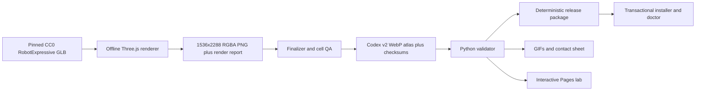
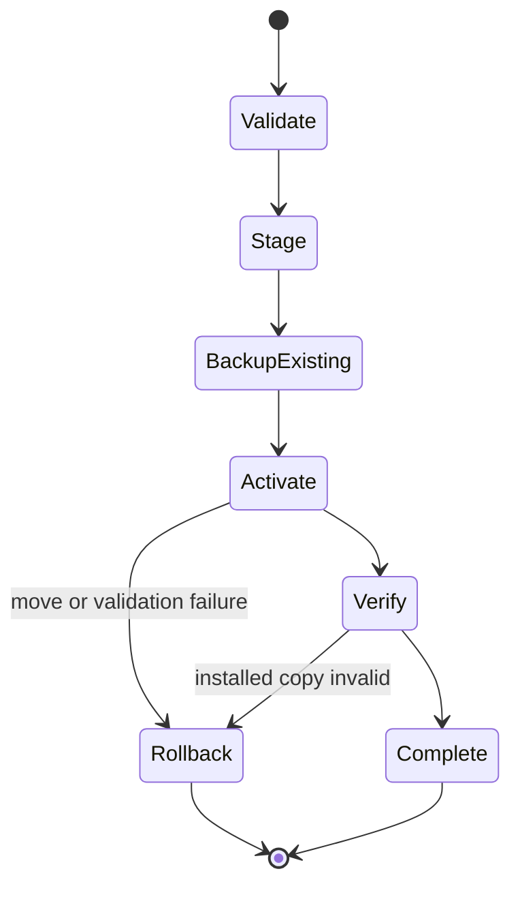

# Architecture

## Data flow

The source model, animation sampling, final atlas, release package, and
installed copy are each checked at a separate boundary. A green web preview
cannot substitute for a valid pet package.

## Atlas contract

- Cell: `192x208`
- Grid: `8x11`
- Atlas: `1536x2288`
- Mode: RGBA
- Format: lossless WebP
- Manifest: `spriteVersionNumber: 2`

| Row | State | Frames | Source |
| ---: | --- | ---: | --- |
| 0 | idle | 6 | `Idle` |
| 1 | running right | 8 | `Running`, body yaw -90° |
| 2 | running left | 8 | `Running`, body yaw +90° |
| 3 | waving | 4 | `Wave` |
| 4 | jumping | 5 | `Jump` |
| 5 | failed | 8 | `Death` |
| 6 | waiting / input needed | 6 | `Sitting` |
| 7 | running / working | 6 | `Punch` |
| 8 | review | 6 | `ThumbsUp` |
| 9–10 | 16 look directions | 16 | `Standing` plus head yaw/pitch |

There are 73 populated cells. Every remaining cell is fully transparent.

## Renderer

`scripts/render_atlas.mjs`:

1. verifies pinned dependencies and the GLB hash;
2. starts an ephemeral HTTP server bound to `127.0.0.1`;
3. serves only explicit local routes plus path-contained Three.js add-ons;
4. launches local Chrome/Edge or Playwright Chromium headlessly;
5. validates required clips and the head bone;
6. computes one pose envelope, then samples animation time deterministically;
7. renders at 4x cell resolution and downsamples to the v2 grid;
8. returns a transparent PNG and JSON report;
9. closes browser and server in `finally` paths.

The renderer has no remote URL and no API-key path. WebGL pixels may differ
across browser/GPU implementations, so source geometry and layout are
reproducible while release-byte determinism begins at the committed atlas.

## Finalizer and validator

`scripts/finalize_atlas.py` verifies the renderer report hash, dimensions,
required/unused cells, and two-pixel edge safety before lossless WebP output.
It writes pet checksums and `artwork/RENDER_REPORT.json`.

`src/robot_pet/atlas.py` independently checks:

- JSON shape, required fields, kebab-case ID, v2, and safe one-file sprite path;
- decoded format, RGBA mode, dimensions, and size;
- all required cells populated and unused cells blank;
- clipping warnings and hidden color in fully transparent pixels;
- SHA-256 entries in `pet/checksums.txt`.

## Packaging and installation

The packager sorts members and fixes timestamps, permissions, compression,
metadata, and line endings. Two builds separated by more than one second must
hash identically.

Archive installation rejects absolute paths, `..` traversal, symlinks,
duplicates, unexpected members, and oversized extracted content. Replacement
uses staging plus atomic moves:

Uninstall moves the installed directory to a timestamped backup instead of
permanently deleting it.

## Repository boundaries

- `artwork/`: immutable upstream input, license/provenance, render evidence
- `pet/`: only files installed as the pet
- `src/robot_pet/`: reusable Python behavior
- `scripts/`: rendering, finalization, builds, wrappers, release gate
- `tests/`: valid-path and adversarial failure cases
- `web/`: dependency-free lab reading the built atlas and validation JSON
- generated `tmp/`, `dist/`, `media/`, and `site/`: ignored build outputs
